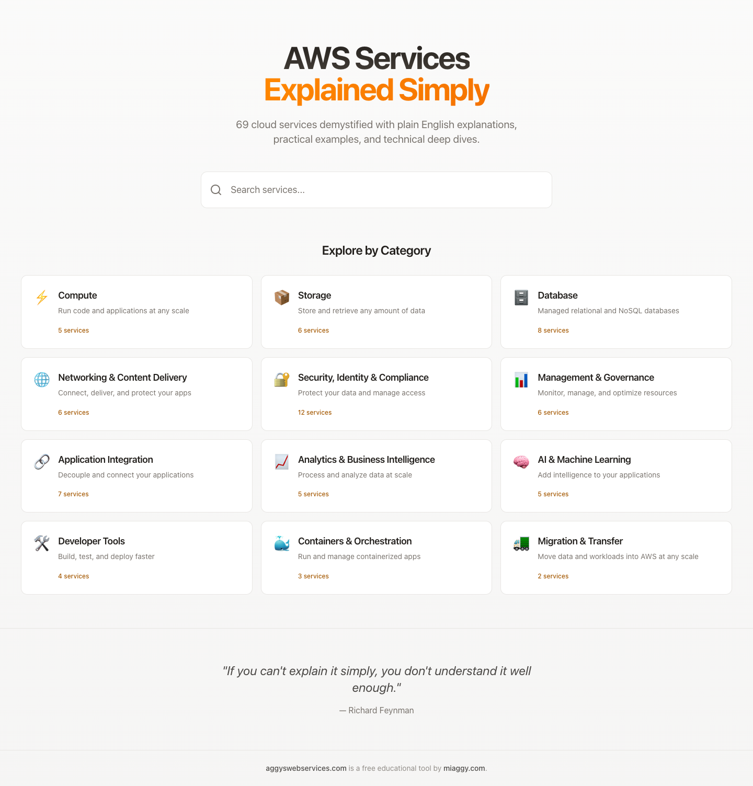

# AWS in Plain English

> Understanding AWS should not require a PhD.

**Live at [aggyswebservices.com](https://aggyswebservices.com).** 69 AWS services across 12 categories, each explained with a plain-language analogy, the gotchas that bite in practice, a worked scenario, and a link to the official docs. Free, no account.



## Who it is for

- AWS beginners who want plain-language explanations
- Engineers moving over from another cloud
- Certification learners
- Sales and pre-sales teams who need to describe services accurately

## What you get

Every service page has:

- A plain-English analogy
- Architecture and implementation gotchas
- A worked scenario with company names, dollar figures, and metrics
- A link to the official AWS documentation

Keyword search covers service names, descriptions, categories, and curated search terms.

> The company names, dollar figures, and metrics in the scenarios are illustrative, not current AWS pricing or real customer data. They exist to make the examples concrete. Service names, limits, and availability are the parts kept current; the scenario numbers are not maintained to the dollar.

## The 12 categories

Compute (5), Storage (6), Database (8), Networking & Content Delivery (6), Security, Identity & Compliance (12), Management & Governance (6), Application Integration (7), Analytics & Business Intelligence (5), AI & Machine Learning (5), Developer Tools (4), Containers & Orchestration (3), Migration & Transfer (2). 69 services in total; `npm run validate:data` checks the dataset against the site's schema.

The code is MIT licensed; see [LICENSE](LICENSE). The content is for educational use; see the [content license](https://aggyswebservices.com/license/).

---

## Run it locally

```bash
npm install
npm run dev        # http://localhost:8080
```

```bash
npm test           # Vitest + Testing Library
npm run build      # validates data, prerenders, writes dist/
```

## Tech stack

React 18, TypeScript, Vite, Tailwind CSS with Radix UI/shadcn-style components, React Router, react-helmet-async (SEO and JSON-LD), vite-prerender-plugin (static prerender), Vitest.

## Project layout

```text
src/
  components/   App and UI components
  data/         AWS dataset (aws-services.json)
  hooks/        React hooks
  lib/          Data helpers and utilities
  pages/        Route-level pages
  test/         Vitest setup
  types/        TypeScript types
public/         Static assets and metadata (robots, sitemap, RSS, feed.json)
scripts/        Build-time generators and validators (sitemap, RSS, feeds, data)
cloudfront/     CloudFront function and error-response config
```

## Deployment

`deploy.sh` is gitignored. It runs lint, tests, and the build, then syncs `dist/` to S3 and invalidates the CloudFront cache. CloudFront serves the SPA; `cloudfront/` holds the trailing-slash redirect function and the error-response config.
